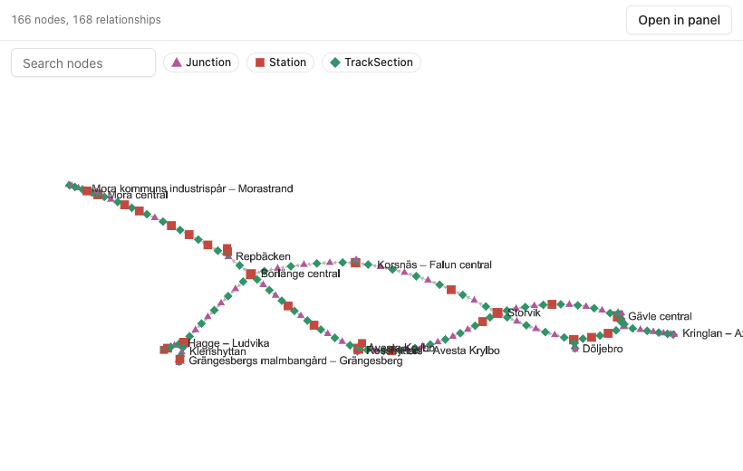

# mcp-graph-explorer

Ask questions about a graph database in Claude Desktop and see the answer as an interactive graph
in the side panel, where it does not scroll away.

Claude writes Cypher and this MCP server runs it against Neo4j or Memgraph over Bolt. Claude can
explore and check without showing anything, and then shows the final answer in an
[MCP Apps](https://github.com/modelcontextprotocol/ext-apps) view as a graph, a table or a single
value.



## Quick start

Requirements: Node 22 or later, pnpm, Docker and Claude Desktop.

```bash
docker compose -f docker/compose.yaml up -d
pnpm install
pnpm build
```

This starts Neo4j on `bolt://localhost:7687` (user `neo4j`, password `graphexplorer`) and Memgraph
on `bolt://localhost:7688` (no login), both loaded with the same railway network: 82 operational
points and 84 sections of line in Dalarna and Gävle, Sweden ([data source](#data)).

```
(:Station | :Junction)-[:CONNECTS]->(:TrackSection)-[:CONNECTS]->(:Station | :Junction)
```

Add the server to `claude_desktop_config.json` (on macOS in
`~/Library/Application Support/Claude/`), with absolute paths:

```json
{
  "mcpServers": {
    "graph-explorer": {
      "command": "/absolute/path/to/node",
      "args": ["/absolute/path/to/mcp-graph-explorer/packages/server/dist/index.js"],
      "env": {
        "GRAPH_URI": "bolt://localhost:7687",
        "GRAPH_USER": "neo4j",
        "GRAPH_PASSWORD": "graphexplorer",
        "GRAPH_DIALECT": "neo4j",
        "GRAPH_ACCESS_MODE": "read"
      }
    }
  }
}
```

For Memgraph use `"GRAPH_URI": "bolt://localhost:7688"` and `"GRAPH_DIALECT": "memgraph"`, and
leave out user and password. Reload the MCP configuration (Developer menu) or restart Claude
Desktop, then ask for example "Show the whole railway network".

| Variable | Default | Meaning |
|---|---|---|
| `GRAPH_URI` | `bolt://localhost:7687` | Bolt address |
| `GRAPH_USER`, `GRAPH_PASSWORD` | empty | Login |
| `GRAPH_DATABASE` | server default | Database name |
| `GRAPH_DIALECT` | `neo4j` | `neo4j` or `memgraph` |
| `GRAPH_ACCESS_MODE` | `read` | `read` or `write`, see below |
| `GRAPH_STATE_DIR` | platform data directory | Where the selected node id is kept |

## What you can do

- **Graph, table or value**, depending on what the query returns.
- **Click a node** to see its properties, and **Expand** to add its neighbors.
- **Refer to the selection in the chat** ("what connects to this one?"). Claude looks it up with
  `get_selection`.
- **Drag** nodes to rearrange them.
- **Choose a layout:** force-directed (default), circular, or geographic when nodes have `lat`/`lon`,
  `latitude`/`longitude` or a WGS 84 point property. Geographic draws no background map, and places
  nodes without coordinates between their neighbors.
- **Search** nodes and **filter** by label.
- Earlier results stay in the chat and can be opened in the panel again.

| Tool | For | Does |
|---|---|---|
| `get_schema` | Claude | Labels, relationship types and properties with example values |
| `query_cypher` | Claude | Runs a query and returns the data; shows nothing |
| `show_result` | Claude | Runs `answer_query`, optionally `context_query`, and shows the result |
| `get_selection` | Claude | The node you last clicked, with its neighbors |
| `select_node`, `expand_node` | the view | Not visible to Claude |

## Security

### Read-only by default

The queries are written by a language model. It can misunderstand you, and text stored in your
data can influence what it does. Therefore the server is read-only unless you say otherwise: it
runs every query in a read-mode transaction that is always rolled back, so the database itself
rejects writes.

Memgraph ignores read mode for auto-commit queries. The server never uses them.

### Write mode

Setting `GRAPH_ACCESS_MODE=write` is your decision. Know what it means:

- Claude's `query_cypher` can **create, change and delete data**, and it is committed immediately.
  There is no undo.
- If you have chosen "Always allow" for `query_cypher` in Claude Desktop, **you are not asked** before a
  write.
- `show_result`, schema reading, expanding and selection stay read-only.
- The view does not say that something was written; only Claude is told what changed.
- Use it against data you can restore.

### What read mode does not stop

- `LOAD CSV` only reads, but it reads from the **database server**: files in Memgraph, network
  addresses in Neo4j.
- Procedures installed in your database may have side effects outside the transaction.
- Neo4j administration commands that are not writes: with an administrator login, `SHOW TRANSACTIONS`
  shows other users' query text and parameters, and `TERMINATE TRANSACTIONS` stops their queries.
  Neo4j Community Edition has no restricted users, so do not point the server at a shared instance there.

If your database edition supports users with limited rights, connect with one that can only read.

### What is sent to Claude

Schema example values, the data returned by `query_cypher` (up to 100 nodes, 100 relationships and
20,000 characters per call), `show_result` summaries (including up to 50 table rows) and the selected
node with its neighbors are sent to Claude. The complete graph of a shown result is part of the tool
result, which Claude Desktop keeps with the conversation.

## Limits

At most 1,000 rows, 500 nodes and 2,000 relationships per result, a 30 second query timeout, and a
size limit on what the view receives. Cuts are reported to Claude and shown in the view.

- Built and tested for Claude Desktop with a local (stdio) server. Other MCP Apps hosts are untested.
- The side panel is not available to every organization; the view also works inside the chat.
- The selected node is shared between chats: the last click wins.
- Expanded nodes, dragged positions and the chosen layout are gone if the view is reloaded.

## Development

```bash
pnpm test               # builds and runs the unit tests
pnpm test:integration   # needs the databases from docker compose
pnpm --filter @mcp-graph-explorer/view dev   # the view with example data
```

| Package | Contents |
|---|---|
| `packages/normalizer` | Driver results to a JSON-safe graph and table; no MCP dependencies |
| `packages/server` | MCP server, dialects, limits |
| `packages/view` | The view, built into one HTML file (React, shadcn/ui, Sigma) |

Design notes are in [docs/](docs/) (the first version's design and plan are in Swedish).

## Data

The example network is a subset of the [Register of Infrastructure (RINF)](https://data.europa.eu/949)
published as open data by the European Union Agency for Railways. It is regenerated with
`node docker/make-seed.mjs <directory with the RINF CSV exports>`. The direction of `CONNECTS`
follows the start and end of each section in RINF and does not restrict traffic. The data is example
content: it may be outdated and must not be used for operations.

## License

[Apache-2.0](LICENSE) for the code. The RINF data in `docker/seed.cypher` is not covered by it;
the publisher's terms apply.
